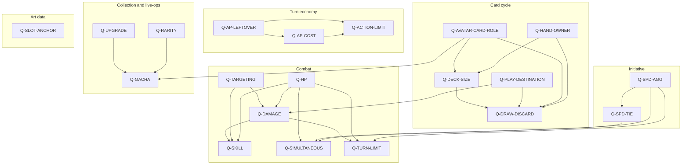

# Design dependency map

**PROPOSALS ONLY. Nothing in this file is an approved rule.**

This map groups the proposals in `docs/DESIGN_DECISION_RESEARCH.md`. An arrow means "decide the source first." The target depends on it. The graph is a decision order, not a map of implemented systems. Owner approval required: **YES** before any node becomes a default. This file does not implement a rule and must not be treated as `PRODUCTION_READY`.

`Q-RARITY` and `Q-TARGETING` are already in `docs/OPEN_DESIGN_DECISIONS.md`. They are not newly identified.

`Q-AVATAR-CARD-ROLE` is newly identified. It is a research label in these docs only. It is not a heading in the question file.

Fixed constants that are not nodes: party size 4, hand size 5, base AP 5, the four faction ids, the four starter avatar ids, and the action types `ATK`, `DEF`, and `Skill`.

## Groups

| Group | Decisions | What the group settles |
|---|---|---|
| Card cycle | Q-HAND-OWNER, Q-AVATAR-CARD-ROLE, Q-PLAY-DESTINATION, Q-DRAW-DISCARD, Q-DECK-SIZE | Whose row of 5, what is dealt, where a played card goes, how the row refills, how long a constructed deck is |
| Turn economy | Q-AP-LEFTOVER, Q-AP-COST, Q-ACTION-LIMIT | What 5 AP means and how many cards it can pay for |
| Initiative | Q-SPD-AGG, Q-SPD-TIE | The one team number, and who moves when the numbers match |
| Combat | Q-HP, Q-TARGETING, Q-DAMAGE, Q-SKILL, Q-SIMULTANEOUS, Q-TURN-LIMIT | Who can fall, who is tapped, what ATK and DEF do, what Skill does, how a double defeat and a stalled fight end |
| Collection | Q-RARITY, Q-UPGRADE, Q-GACHA | Gem names, gear levels, and the pull structure |
| Art data | Q-SLOT-ANCHOR | Whether an item stores its anchor name |

`Q-SLOT-ANCHOR` has no combat or economy dependency. It can be decided at any time. It does not unblock the Battle Demo.

## Dependency graph

`Q-SLOT-ANCHOR` is drawn alone on purpose.

Reading the combat chain: destination before damage, because the recommended DEF card becomes expiring Block rather than a card that stays on the table. HP and targeting before damage and Skill. Damage before Skill, because Pierce reuses the Block step. Damage before the turn cap, because the cap exists to stop 0-damage stalls. Initiative before simultaneous defeat and the turn-cap tie, because both propose that the side which did not start wins the leftover tie.

Reading the card chain: hand owner and avatar-card role before deck size and draw. Play destination before draw, because the recycle reads the discard pile. Deck size before a constructed draw. A scripted demo pile does not need the lasting cap, which is why deck size is pre-alpha below.

## Tiers

### Demo-blocking

Required before a playable Battle Demo: a local 4v4 fight that starts, fills a hand, spends AP, resolves ATK, DEF, and Skill onto avatars, and names a winner.

| Order | Id | Why it blocks | What the code does today |
|---|---|---|---|
| 1 | Q-HAND-OWNER | The draw fills a specific row. The demo would otherwise display an unconfirmed owner | Already one hand per side. Confirmation |
| 2 | Q-AVATAR-CARD-ROLE | The dealt pile must know whether `AVC_*` cards occupy the five slots | Play rejects them with `NOT_ACTION_CARD`. Their job is undesigned |
| 3 | Q-PLAY-DESTINATION | Recycle needs a zone. The log is not a zone | Card leaves the hand and is appended to `playedRecords` |
| 4 | Q-DRAW-DISCARD | Hands start empty, and a played card cannot be played again while it is gone | `drawCards` and `discardCard` throw. `addCard` can script a hand |
| 5 | Q-AP-LEFTOVER | The pip row is the turn. The demo must not present an unconfirmed economy | Already sets that side's AP to 5. Confirmation |
| 6 | Q-AP-COST | A null cost throws. An integer on the card is already used, so the number *is* the decision | Throws on null. Schema examples are null |
| 7 | Q-ACTION-LIMIT | Every play calls the hook, even when the card has an integer cost | Throws on every play |
| 8 | Q-SPD-AGG | `createBattle` throws without a team number | Does not sum, average, or take the max itself |
| 9 | Q-SPD-TIE | Equal team numbers throw | No built-in preference and no coin flip |
| 10 | Q-HP | `createBattle` calls `isSideDefeated` immediately | No HP field. Stats stay POW, DEF, SPD |
| 11 | Q-TARGETING | Four portraits need a subject. The engine will not invent one | `playCard` takes no target and does not throw for that |
| 12 | Q-DAMAGE | ATK and DEF resolution throws. A successful `playCard` currently applies nothing | `playCard` does not call `resolveEffect` |
| 13 | Q-SKILL | A Skill in the hand cannot resolve. "No Skill cards in the demo pile" is a smaller legal answer | `resolveEffect` throws `Q-SKILL` |
| 14 | Q-SIMULTANEOUS | Both predicates true throws, and `endTurn` rolls back | A result must be one of the two side ids. A draw is rejected |
| 15 | Q-TURN-LIMIT | The damage proposal allows 0. Two guarding sides never finish | No cap and no fatigue |

That list of 15 is the minimum set.

### Pre-alpha

Needed before players build decks, collect ranks, upgrade gear, or before sprite placement retires the slot map. Not required to finish a scripted fight.

| Order | Id | Why it can wait |
|---|---|---|
| 16 | Q-DECK-SIZE | `createDeck` accepts any list. The draw proposal needs a pile of at least 5 action cards, not a lasting cap. A representative demo should still script 20 if that proposal is the one being previewed |
| 17 | Q-RARITY | The fight reads printed numbers and stats. The gem and the rank names matter once cards are authored for a collection |
| 18 | Q-UPGRADE | Levels change the next battle's stats. The demo can use base stats |
| 19 | Q-SLOT-ANCHOR | Placement data. A non-rendering battle demo does not consult anchors |

### Live-ops

| Order | Id | Why it is last |
|---|---|---|
| 20 | Q-GACHA | Odds, pity, and duplicate conversion sit outside the battle. They need the rarity names and an upgrade sink first, plus a disclosure pass before any real-money banner. No rate is proposed |

## If a different alternative is approved

The package in the research doc was written to fit together. A different alternative reopens the rows in the same row of this table.

| Different choice | Re-read before approving the neighbors |
|---|---|
| One hand per avatar, or one shared match hand | Q-DRAW-DISCARD, Q-DECK-SIZE, Q-AP-COST, Q-TARGETING |
| Avatar cards become playable, or become commanders | Q-DECK-SIZE, Q-DRAW-DISCARD, Q-AP-COST, Q-GACHA |
| A played card stays in play | Q-DAMAGE, Q-DRAW-DISCARD, Q-SKILL |
| A played card leaves the match and does not recycle | Q-DRAW-DISCARD, Q-TURN-LIMIT, Q-DECK-SIZE |
| Logged shuffle, or a random target | Q-SPD-TIE, and the battle core's lack of RNG |
| Bank AP, or bank AP up to 10 | Q-AP-COST, Q-ACTION-LIMIT |
| One cost per action type, or an avatar cost discount | Q-ACTION-LIMIT, Q-TARGETING, Q-SKILL |
| One card per turn, or a Skill sub-cap | Q-AP-COST, Q-DRAW-DISCARD |
| Highest SPD or lowest SPD as the team number | Q-SPD-TIE, Q-UPGRADE |
| POW-sum tie-break, or a logged coin flip | Q-DAMAGE, Q-SIMULTANEOUS |
| Shared party HP, or "lose when any one avatar falls" | Q-DAMAGE, Q-TARGETING, Q-SKILL, Q-TURN-LIMIT, Q-SIMULTANEOUS |
| DEF permanently raises DEF, or hits ignore POW and DEF | Q-SKILL, Q-TURN-LIMIT, Q-PLAY-DESTINATION |
| Skill is only a bigger ATK, or each faction has a passive | Q-AP-COST, Q-TARGETING, Q-DECK-SIZE |
| Simultaneous result is overkill, or a draw | Q-HP, and for a draw the engine's side-id check |
| No turn cap, or fatigue damage | Q-DAMAGE, Q-DRAW-DISCARD |
| Deck of 12 or deck of 30 | Q-DRAW-DISCARD pacing, Q-GACHA duplicate room |
| Rarity multiplies damage | Q-DAMAGE, Q-AP-COST, Q-GACHA |
| Avatar levels, or one-step card upgrades | Q-HP, Q-GACHA, Q-DAMAGE |
| Keep the slot map, or require both anchor sources | Art pass only. Combat rows stay put |

## Engine gaps that are not extra decisions

These are facts about `dba87d7`. They explain why approval of the demo set still does not make a fight run.

- `playCard` spends AP and records `effect: "not_applied"`. It does not call `resolveEffect` or `evaluateOutcome`.
- `evaluateOutcome` runs at battle creation and inside `endTurn`. A lethal hit is invisible until something calls it.
- `endTurn` restores the previous turn if that call throws. An unresolved double defeat cancels the turn change.
- `src/` contains no random source. A shuffle or a coin flip has to be an injected, logged seed, or it has to stay outside the battle.
- `tests/helpers/stub-rules.js` is TEST-ONLY. The proposals do not copy those functions into the game. The sum, the all-KO marker, and the "no extra action cap" stub happen to resemble three proposals. The draw-one stub does not resemble the draw proposal.
- Starter POW, DEF, and SPD are still `TBD`. Approving a formula does not fill them. A demo needs a later content pass for those integers and for battle HP. This map does not choose the numbers.
